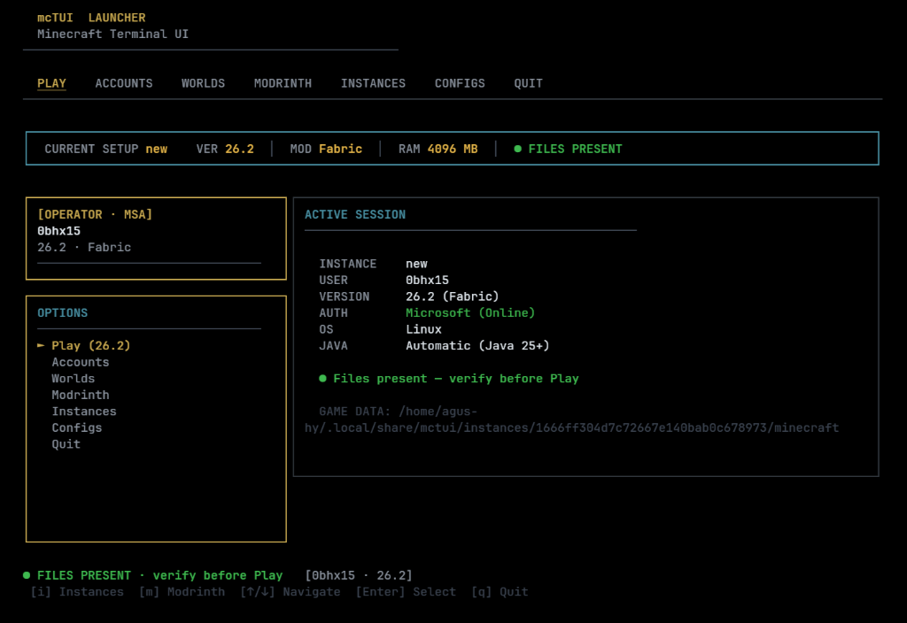

<h1 align="center">mcTUI</h1>

<p align="center">
  
</p>

<p align="center">
  A terminal launcher for Minecraft: Java Edition.<br>
  <strong>Instances | Modrinth | Modpacks | Worlds</strong><br>
  Written in Go for Linux, macOS, and Windows.
</p>

<p align="center">
  <a href="https://agmonetti.github.io/mcTuiDocs/">Documentation</a> |
  <a href="https://github.com/agmonetti/mcTUI/releases/latest">Latest release</a>
</p>


---

## Requirements

- A legitimately purchased copy of Minecraft: Java Edition. mcTUI does not provide a game license or Microsoft authentication.
- A compatible Java installation available on your system. The required version depends on the Minecraft version you select.
- An existing official `.minecraft` installation if you want to manage your legacy game data. Managed instances use separate directories.

## Features

- Terminal interface with keyboard navigation, powered by [Bubble Tea](https://github.com/charmbracelet/bubbletea).
- Separate instances with their own Minecraft version, Fabric loader, Java runtime, and memory allocation.
- Modrinth search and installation for mods, resource packs, and shaders, including dependency resolution.
- Import, update, and export of Modrinth `.mrpack` modpacks.
- Copy worlds between instances and the legacy `.minecraft` directory with compatibility warnings.
- Reset mod configurations with optional backups without removing worlds or shaders.
- Concurrent downloads with hash verification.
- Automatic Java detection and English and Spanish interfaces.
- Linux, macOS, and Windows support.

## Installation

Download the executable for your operating system from the [latest release](https://github.com/agmonetti/mcTUI/releases/latest). On Linux and macOS, make it executable before running it. On Windows, run the downloaded `.exe` from PowerShell or File Explorer.

To build from source, install Go 1.26.4 or newer, then run:

```bash
git clone https://github.com/agmonetti/mcTUI.git
cd mcTUI
go build -o mctui .
./mctui
```

On Windows, use `go build -o mctui.exe .` and run `./mctui.exe` in PowerShell instead.

## Documentation

For configuration, paths, features, and development instructions, see the [official documentation](https://agmonetti.github.io/mcTuiDocs/).

## Disclaimer

mcTUI is an independent project and is not affiliated with Mojang or Microsoft. It does not provide a Minecraft license or Microsoft authentication. It can download game files from official sources to prepare a local instance, but does not grant access to online-mode servers. Its offline username mode is intended for local or explicitly configured LAN servers. You must own Minecraft: Java Edition to use it legitimately.
